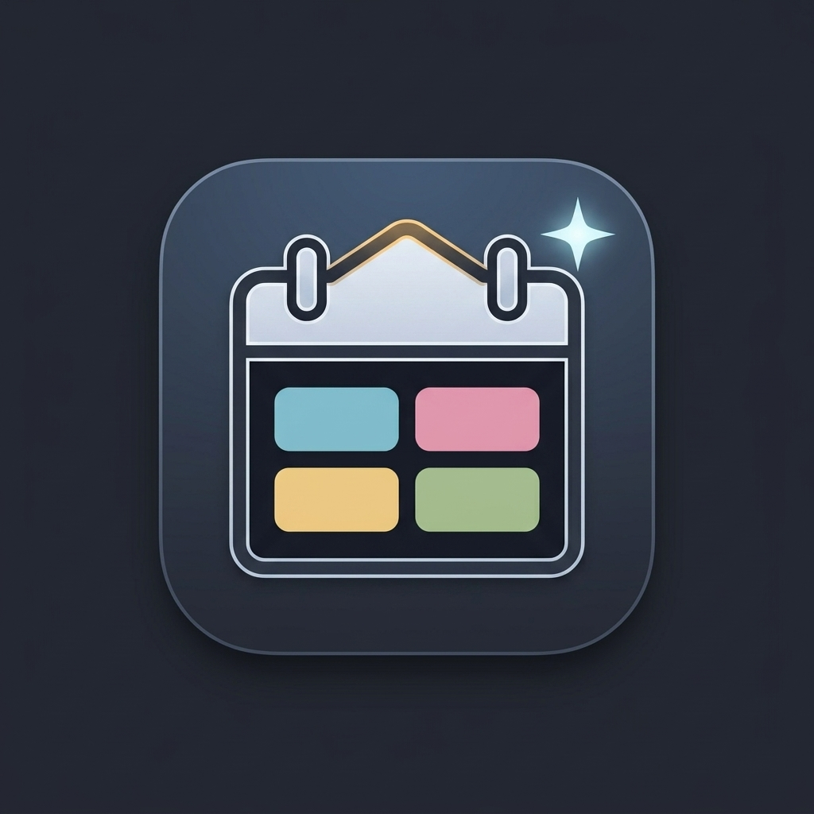
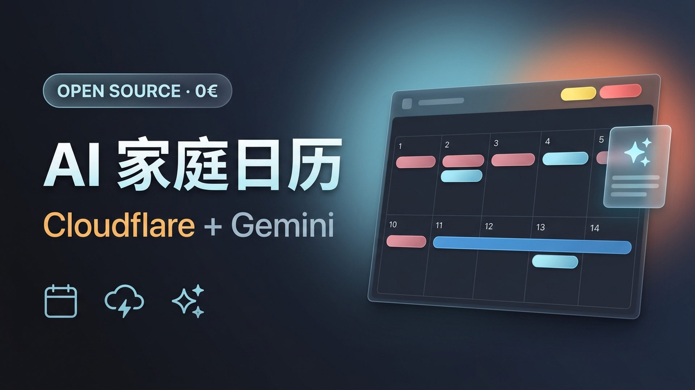

<p align="center">
  
</p>

<h1 align="center">FamilyCalendar · Household Operations &amp; AI Planner (v1.0.0)</h1>

<p align="center">
  
</p>

A lightweight, self-hosted **family operations calendar** built on **Cloudflare Workers + Workers Static Assets + D1 (SQLite) + Hono + React + Google Gemini AI**.

Designed for real households where standard calendars fall short: irregular shift schedules with variable work hours, school A/B week timetables & vacation skips, school strike alerts, electricity tariff alerts (French EDF Tempo), 7-day advance deadline/payment radar, multi-line family inbox, and human-in-the-loop AI scheduling.

> **零成本全栈单项目部署**：前端 SPA + 后端 API + D1 SQLite 数据库 + 每日定时 Cron 全在一个 Cloudflare Worker 里；外层套一层 Cloudflare Access 邮箱白名单锁权，外人和搜索引擎完全无法访问。

---

## Core Features / 核心特性

- **2-Week Default View + Month View + Mobile Cards**: Desktop defaults to a spacious 2-week grid with true **continuous multi-day spanning bars**; phones (`< 760px`) automatically switch to a vertical daily card list.
- **Daily Household Status Layer (`daily_status`)**: Compact per-day status pills without cluttering the calendar:
  - Irregular shift schedule with exact hours & quick-fill presets (e.g. `09:45-17:45`, `11:45-19:45`, `Repos`, `Leave`)
  - Second adult status (`Work`, `WFH`, `Leave`, `Travel`, `Off`)
  - School status (`Normal`, `Strike / Grève`, `Partial strike`, `Holiday`)
  - Live **EDF Tempo** daily sync (`api-couleur-tempo.fr`, silent on Blue days, alerts on White/Red days)
- **Collapsible 7-Day Upcoming Radar**: Surfaces Tempo White/Red days, school strikes, deadlines, bill payments, exams, and unbooked outings with one-click completion and collapse toggle.
- **Batch Weekly Recurring Events**: Create full-term weekly classes/activities in one click while automatically skipping school holidays (`POST /api/events/batch`).
- **Folded A/B Week Timetable & Quick Links**: Keeps school timetables folded by default with automatic Week A/B & holiday detection, plus a collapsible family links bar.
- **Human-in-the-Loop AI + Shift Photo Vision**:
  - Multi-line family Todo Inbox → nightly Cron (`21:30`) or manual button parses into a **Pending Review Queue** (manual confirmation before writing to calendar).
  - Upload a photo/screenshot of a shift schedule → Gemini multimodal vision extracts shifts into the review queue with inline editing and one-click batch confirm.
  - **Built-in Offline Demo AI Mode (`DEMO_AI_MODE=true`)**: Try the AI review UI locally even without a `GEMINI_API_KEY`.
- **3 Eye-Friendly Themes**: One-click switch between **Nord** (default dark), **Tokyo Night** (indigo dark), and **Warm Parchment** (soft non-white light), saved per device.

---

## Required Services, APIs & Cost / 所需服务、API 与费用清单

| Service / API | Required? | Purpose / 用途 | Cost / 费用 |
| :--- | :---: | :--- | :--- |
| **Cloudflare Workers + Static Assets** | Required | Hosts frontend SPA, Hono CRUD API, and daily Cron Triggers in a single project | **Free** (100,000 req/day) |
| **Cloudflare D1 (SQLite)** | Required | Serverless SQLite database storing all schedules, events, timetables, todos, links | **Free** (5M reads/day, 100k writes/day, 5 GB, no credit card) |
| **Cloudflare Access (Zero Trust)** | Recommended | Email allowlist login gate (One-time PIN works with Gmail/Hotmail/any email) | **Free** (up to 50 users) |
| **Google AI Studio (`GEMINI_API_KEY`)** | Optional | Natural-language Todo parsing & multimodal shift-photo vision (`gemini-3.8-flash`) | Free tier or Paid ~€0.05/month (Paid tier does not train on your data) |
| **EDF Tempo Public API** | Optional (FR) | Auto-fetches France EDF Tempo daily color (`api-couleur-tempo.fr`) | **Free**, no API key |
| **Google Apps Script (Gmail)** | Optional | Pushes selected school/booking emails without 7-day OAuth expiry (`gas/Code.gs`) | **Free**, no credit card |

---

## Quick Start: Local SQLite Demo (30 Seconds / 本地一键启动演示)

Prerequisites: **Node.js 20+**

```bash
git clone https://github.com/dongzn2017/family-calendar-oss.git
cd family-calendar-oss

# 1. Install dependencies
npm install

# 2. Initialize local D1 SQLite database with dynamic demo data (anchored to today)
npm run demo:setup

# 3. Start local full-stack dev server (React + Hono + local SQLite D1)
npm run dev
```

Open **http://localhost:5173**!
- Demo data is dynamically anchored to `date('now')`, so you immediately see today's shifts, a multi-day trip bar, 7-day radar alerts, A/B timetable, sample todos, and a review queue notice.
- Click **「AI 整理」** or **「传班表」** to test the offline Demo AI mode with zero API key. To reset demo data anytime: `npm run db:seed:demo`.

---

## Deploy with an AI Coding Assistant (Recommended / 用 AI 助手一键协作部署)

If you use an AI coding agent (**Antigravity**, **Claude Code**, **Cursor**, **Codex CLI**, etc.), you do not need to memorize Wrangler or D1 commands:

### Step 1: Prepare your 3 accounts/keys (once)
1. **GitHub account** (logged in via `gh auth login`, or fork this repo as a **Private** repo for your own household).
2. **Cloudflare account** (run `npx wrangler login` once in your terminal so the CLI can create D1 and deploy Workers; optionally install the Cloudflare plugin/MCP for read-only verification).
3. **Google AI Studio API Key** (optional): generate a `GEMINI_API_KEY` at [aistudio.google.com](https://aistudio.google.com).

### Step 2: Hand this prompt to your AI assistant inside the repo folder

```text
Help me customize and deploy this FamilyCalendar repo for my own household:
1. Update src/shared/household.ts and migrations/0001_init.sql with my family members:
   - Partner A: <Name>, Partner B (shift worker): <Name>, Child A: <Name>, Child B: <Name>
   - Timezone: <e.g. Europe/Paris>, School vacations: <your dates>
2. Create a remote Cloudflare D1 database named `family-calendar-db` (region: <weur/wnam/apac>),
   update database_id in wrangler.jsonc, set DEMO_AI_MODE to "false", and apply migrations/0001_init.sql & 0002_ab_and_links.sql to --remote.
3. Build and deploy to Cloudflare Workers (`npm run deploy`), then guide me to store GEMINI_API_KEY as an encrypted Worker Secret (`npx wrangler secret put GEMINI_API_KEY`).
4. Guide me to lock down the production URL in Cloudflare Zero Trust Access using exact `Emails` allowlist policies for our family emails.
```

> **Tip for migrating existing schedules**: You can also paste screenshots of your shift schedules or school timetables directly to your AI assistant — ask it to generate a gitignored `local-data/seed.sql` and load it into `--remote` D1 while keeping your private data completely out of Git!

---

## Manual Deployment to Cloudflare (Step-by-Step / 手工部署步骤)

### 1. Customize household names & holidays
Edit **`src/shared/household.ts`** (names, shift quick-fill presets, school vacations) and **`migrations/0001_init.sql`** (initial `members` table names).

### 2. Create remote D1 database & bind it
```bash
npx wrangler login
npx wrangler d1 create family-calendar-db --location weur
```
Copy the returned `database_id` into **`wrangler.jsonc`**, and change `"DEMO_AI_MODE": "false"` once you plan to use real Gemini.

### 3. Apply database schema migrations to remote D1
```bash
npx wrangler d1 execute DB --remote --file=migrations/0001_init.sql
npx wrangler d1 execute DB --remote --file=migrations/0002_ab_and_links.sql
```
*(Optional: to load demo data into remote D1 for testing, also run `npx wrangler d1 execute DB --remote --file=seeds/demo.sql`.)*

### 4. Deploy Worker & configure encrypted Gemini Secret
```bash
npm run deploy

# Add your Google AI Studio key as an encrypted Worker Secret (never commit to Git!)
npx wrangler secret put GEMINI_API_KEY
```
> **Important**: Always add `GEMINI_API_KEY` as an encrypted **Secret** (via `wrangler secret put` or Cloudflare Dashboard *Type: Secret*), NOT as a plaintext Variable — otherwise future `wrangler deploy` runs will overwrite dashboard plaintext variables.

### 5. Lock down access with Cloudflare Access (Zero Trust)
To ensure strangers and search engines cannot view your family calendar:
1. Open the full **Cloudflare Zero Trust Dashboard**: [one.dash.cloudflare.com](https://one.dash.cloudflare.com).
2. Go to **Access → Policies → Add a policy**:
   - Action: `Allow`
   - Session duration: `1 month` (`730h`) or `7 days` (`168h`) — you only enter a 6-digit email code once per period!
   - Include → Selector: choose **`Emails`** *(not `Emails ending in`, which only matches domains!)* and enter your household email addresses.
3. Go to **Access → Applications → Add an application → Self-hosted**:
   - Domain: your Worker URL (e.g. `family-calendar.<your-subdomain>.workers.dev` or a custom subdomain like `cal.yourdomain.com`).
   - Attach the Allow policy above and keep **One-time PIN** enabled.
4. Keep `"preview_urls": false` in `wrangler.jsonc` so unguarded preview URLs are not exposed.

### 6. Optional: Auto-Deploy on `git push`
In Cloudflare Dashboard → **Workers & Pages → `family-calendar` → Settings → Build → Connect Git**, connect your private fork:
- Build command: `npm run build`
- Deploy command: `npx wrangler deploy`

---

## Optional: Gmail Sync via Google Apps Script

If you want selected school/medical/booking emails auto-pushed into `/api/ingest/gmail`, see [`gas/README.md`](./gas/README.md) and [`gas/Code.gs`](./gas/Code.gs). If you prefer not to grant Gmail permissions, simply paste key email excerpts into the multi-line Todo Inbox and click **「AI 整理」**.

---

## Tech Stack

- **Frontend**: React 19, Vite 6, TypeScript, Lucide Icons, CSS Variables (Nord / Tokyo Night / Warm Parchment)
- **Backend**: Cloudflare Workers + Workers Static Assets + Hono + Cron Triggers (`30 10 * * *` Tempo sync, `30 20 * * *` nightly AI organizer)
- **Database**: Cloudflare D1 (SQLite)
- **AI**: Google Gemini API (`gemini-3.8-flash` with 3-attempt automatic backoff retry on 503/429)

## License

[MIT](./LICENSE)
